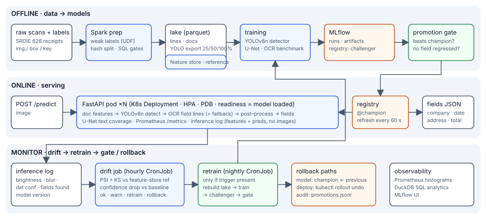

# DocPipe — receipt & invoice field extraction with a production MLOps loop

> Scanned receipt in → `company / date / address / total` out, with the full model
> lifecycle around it: Spark data prep, feature store, MLflow tracking + registry,
> gated promotion, FastAPI serving on Kubernetes, drift detection, automatic retraining,
> and two independent rollback paths.



Built on **ICDAR-2019 SROIE** (626 real scanned receipts). Trains end-to-end on a
2-vCPU laptop in about two hours; nothing needs a GPU.

## What is in the box

| Capability | How |
|---|---|
| **Detection** | YOLOv8n fine-tuned to detect text lines *and* classify them as `company / date / address / total / other` — one model does localisation and key-information extraction |
| **Segmentation** | 0.5 M-param U-Net producing a text-region mask; its coverage and confidence are cheap health signals |
| **OCR** | Tesseract 5 on the field lines only, with a benchmarked preprocessing recipe and a digit-whitelisted second pass for amounts |
| **Big-data prep** | PySpark job: raw annotations → partitioned parquet lake, weak-label derivation via UDF, hash-based splits, SQL quality gates. Same code on `local[*]` and on a cluster |
| **SQL** | Spark SQL gates; DuckDB over the lake, the feature store and the inference log (`sql/analytics.sql`) |
| **Feature store** | Offline (parquet + DuckDB, point-in-time correct) and online (SQLite, TTL) with a Feast-shaped API; one feature function shared by training and serving |
| **Experiment tracking** | MLflow: params, dataset hash, git SHA, per-epoch metrics, artifacts, nested runs for the OCR benchmark |
| **Model registry** | `challenger → champion → previous` aliases; promotion gate with per-class regression checks; audit trail |
| **Serving** | FastAPI, liveness/readiness split, hot model refresh from the registry, Prometheus metrics, PII-free inference log |
| **Monitoring / drift** | PSI + KS on image features vs the feature-store reference; confidence and fields-found vs a baseline window; severity → action matrix |
| **Retraining trigger** | drift job writes a trigger → CronJob retrains → promotion gate decides |
| **Rollback** | model: alias flip (≤ 60 s, no redeploy); deployment: `kubectl rollout undo` (zero-downtime) |
| **Containers / orchestration** | multi-stage non-root Docker images, Compose stack with MLflow + Prometheus, Kustomize manifests: Deployment, Service, HPA, PDB, CronJobs, overlays |
| **CI** | ruff, pytest, image build, `kubeconform` validation of rendered manifests |
| **Docs** | architecture, reproducible training recipe, runbook, model card, experiments, ADRs, interview guide |

## Results (held-out test split, 97 receipts)

| Model / stage | Metric | Value |
|---|---|---|
| Field detector v1 (YOLOv8n, 12 ep) | test mAP50 | 0.592 |
| Field detector **v2** (continued +12 ep) → promoted by the gate | test mAP50 / mAP50-95 | **0.740** / 0.506 |
| Data scaling 25 % → 50 % → 100 % of labels | test mAP50 | 0.287 → 0.407 → 0.592 |
| Text segmenter (U-Net 0.5 M) | test IoU | 0.825 |
| OCR (Tesseract + best recipe) | CER on 600 test lines | 9.0 % (binarisation made it worse: 11–13 %) |
| End-to-end field extraction, v1 → v2 | macro exact / fuzzy ≥ 90 | 0.27 → **0.37** / 0.37 → **0.50** |
| … `total` | exact | 0.20 → **0.42** |
| … `date` | exact | 0.47 → **0.58** |
| Drift demo (blur + dark + skew + jpeg) | PSI on brightness / blur | 6.9 / 6.9 → `severity: retrain`; clean traffic → `ok` |
| Rollback | champion v2 → v1 → v2 | live pods switched within one 15 s refresh tick, no restart |

Full tables, the data-scaling curve and the drift demo numbers: [`docs/EXPERIMENTS.md`](docs/EXPERIMENTS.md).

## Quick start

```bash
git clone <this repo> && cd docpipe
pip install --extra-index-url https://download.pytorch.org/whl/cpu -r requirements-dev.txt
sudo apt-get install -y tesseract-ocr default-jre-headless     # OCR engine + Java for Spark

make data prep features        # download SROIE, Spark job -> lake, feature store
make train train-seg ocr-eval  # ~1 h on 2 vCPU; each run lands in MLflow as a `challenger`
make promote                   # gate -> `champion`
make serve                     # http://localhost:8000/docs

# Short cut: the repo ships the trained champion in data/mlflow.db + data/mlruns.
# After cloning/unzipping, re-point the store at its new path and serve straight away:
python scripts/relocate_mlflow.py && make data && make serve
curl -F file=@data/raw/img/005.jpg "localhost:8000/predict" | jq .fields
```

Then the monitoring loop (10 minutes):

```bash
make traffic-baseline N=40     # clean receipts        -> tag=baseline
make traffic-drifted  N=40     # blur/dark/skew/jpeg   -> tag=drifted
make drift TAG=drifted         # PSI/KS report, severity=retrain, trigger written
python -m docpipe.monitoring.retrain_if_triggered --epochs 3
make rollback                  # champion -> previous, pods reload within 60 s
make mlflow-ui                 # compare everything at http://localhost:5000
```

### Docker / Kubernetes

```bash
docker compose -f docker/docker-compose.yml up --build      # mlflow :5000, api :8000, prometheus :9090
kubectl apply -k k8s/overlays/local                          # kind / minikube
kubectl apply -k k8s/base                                    # cluster (set image owner/tag in kustomization)
```

## Repository map

```
docpipe/data        download, Spark prep, weak labels, YOLO export
docpipe/features    image features, feature store, build script
docpipe/models      U-Net
docpipe/train       train_detector, train_segmenter, eval_ocr, eval_end2end
docpipe/registry    promote (gate), rollback
docpipe/serving     pipeline, FastAPI app, inference log
docpipe/monitoring  drift, retrain worker, traffic simulator
configs/            drift thresholds
docker/ k8s/        images, compose, kustomize base + local overlay
sql/                DuckDB analytics
tests/              unit + API contract tests (no weights needed)
docs/               ARCHITECTURE, TRAINING_RECIPE, RUNBOOK, MODEL_CARD, EXPERIMENTS, INTERVIEW_GUIDE, adr/
```

## Design notes

* **Models are resolved by registry alias, not baked into images** — promotion and
  rollback are one-command registry operations that reach every pod in ≤ 60 s. Container
  problems have their own lever (`rollout undo`). [ADR 0003]
* **Promotion is a gate.** A challenger must beat the champion on held-out test mAP50,
  may not regress any field by > 5 points, and may not have trained on fewer samples.
* **Drift ≠ rollback.** Input drift means the world changed → retrain. Prediction drift
  with stable inputs right after a model change means we broke it → roll back. The
  monitor tells them apart.
* **One feature function** builds the drift reference and runs on every request, so
  training/serving skew cannot hide inside the monitor.
* **Rules under the model.** When the detector misses `date`/`total`, a bounded OCR
  fallback (TOTAL-row matching, regex validation, digit whitelist) recovers them, and the
  extra cost is logged per request.
* **Honest negative result.** The "obvious" OCR preprocessing (2× upscale + Otsu) made
  CER *worse* on these scans; the benchmark is part of the recipe so nobody re-learns it.

## License

Code: MIT. Dataset: ICDAR-2019 SROIE, research use; see the dataset's own terms.
