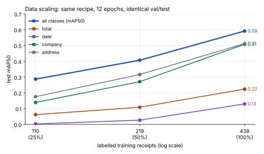

# Experiments

All numbers are from the MLflow runs in this repo's reference build (2 vCPU, CPU-only,
October 2026), evaluated on the **held-out test split (97 receipts, 5,525 text lines)**
that no training or model-selection step ever saw. Reproduce with `docs/TRAINING_RECIPE.md`.

## 1. Detector: production candidates and the promotion gate

| Run | Train receipts | Epochs | Init | mAP50 | mAP50-95 | P | R | company | date | address | total | other | Registry |
|---|---|---|---|---|---|---|---|---|---|---|---|---|---|
| `detector-f100` | 438 | 12 | COCO `yolov8n.pt` | 0.592 | 0.387 | 0.60 | 0.63 | 0.51 | 0.13 | 0.51 | 0.22 | 0.56 | v1 → champion (first) |
| `detector-f100-continued` | 438 | +12 | v1 `best.pt` | **0.740** | **0.506** | 0.69 | 0.68 | 0.56 | 0.34 | 0.60 | 0.43 | 0.60 | v2 → **champion**, v1 → previous |

Per-class columns are mAP50. The gate's log line for v2:

```
{"challenger_version": 2, "challenger_score": 0.7401, "champion_version": 1, "champion_score": 0.5924,
 "gain": 0.1477, "reasons": ["gain +0.1477 vs min_gain 0.0"], "decision": "promote"}
```

Reading: the validation curve was still rising at epoch 12 (0.49 → 0.57 → 0.60 over the
last three epochs), so the second run is simply the same recipe continued; on a GPU this
is one 30-epoch run. `date` and `total` are the rare classes (2 % and 5 % of lines) and
the hardest; both roughly doubled with the extra epochs, which is why the serving
pipeline keeps a rule-based fallback under them (§4).

## 2. Data-scaling experiment: labelled data → accuracy

Same recipe (12 epochs from COCO weights), nested train subsets, identical val/test.

| Train receipts | Fraction | mAP50 | mAP50-95 | date | total |
|---|---|---|---|---|---|
| 110 | 25 % | 0.287 | 0.158 | 0.003 | 0.062 |
| 219 | 50 % | 0.407 | 0.243 | 0.027 | 0.109 |
| 438 | 100 % | 0.592 | 0.387 | 0.130 | 0.224 |



What it says to a delivery-pod lead: **doubling the labelled set is still worth
12–19 mAP50 points (0.29 → 0.41 → 0.59) at this scale, and the rare fields benefit the most** —
the curve has not flattened, so the next batch of annotation budget should go to more
receipts (with `date`/`total` lines prioritised in QA) rather than to model capacity.
The same script (`scripts/run_scaling_experiments.sh`) re-draws this curve for every new
batch, so the decision is re-made with evidence each time.

## 3. Segmenter

| Model | Params | Input | Test IoU | Best val IoU | Mean confidence |
|---|---|---|---|---|---|
| U-Net base-16, BCE+Dice, 6 epochs | ~0.5 M | 160×320 gray | **0.825** | 0.833 | 0.897 |

The mask is a health signal rather than a product output: under the drifted traffic in §5
its mean confidence barely moved (0.896 → 0.885) while OCR confidence fell by 0.16, which
tells us the *layout* is still recognisable and the failure is in *legibility* — a useful
hint when triaging.

## 4. OCR preprocessing benchmark

600 ground-truth line crops from the test split, Tesseract 5.3 LSTM, `--psm 7`.
CER = Levenshtein / len(truth) after upper-casing and whitespace collapse.

| Recipe | CER ↓ | Exact match ↑ | Engine conf | ms / line | CER on `total` lines | CER on `date` lines |
|---|---|---|---|---|---|---|
| raw (grayscale) | 0.0924 | 0.613 | 0.787 | 130 | 0.162 | 0.106 |
| **autocontrast** (cutoff 1 %) | **0.0901** | **0.613** | 0.785 | 127 | **0.155** | **0.106** |
| otsu | 0.1127 | 0.538 | 0.753 | 125 | 0.174 | 0.125 |
| upscale 2× | 0.1201 | 0.565 | 0.758 | 131 | 0.188 | 0.167 |
| upscale 2× + otsu | 0.1326 | 0.532 | 0.752 | 129 | 0.219 | 0.187 |
| upscale 2× + median + autocontrast + otsu | 0.1190 | 0.542 | 0.762 | 131 | 0.216 | 0.168 |

**Negative result, kept on purpose.** The textbook pipeline (upscale + binarise) made CER
*worse* by 3–4 points on these scans: Tesseract's LSTM is trained on grayscale and
thresholding destroys the thin strokes of thermal prints. `autocontrast` wins by a hair and
is what serving uses. For amount boxes specifically, a digit-whitelisted second pass
(`tessedit_char_whitelist=0123456789.,RM$`) reads 76 % of ground-truth amount crops
exactly (120 val crops) versus 73 % unrestricted; the pipeline applies it to every
`total` candidate.

## 5. End-to-end field extraction (the business metric)

Full pipeline (detector → OCR → post-processing with fallback) on the 97 test receipts,
scored against SROIE's key-field ground truth. "Found" = a value was produced; "exact" =
normalised string equality; "fuzzy" = rapidfuzz ratio ≥ 90.

| Field | v1 champion exact | **v2 champion exact** | v2 fuzzy ≥ 90 | v2 found |
|---|---|---|---|---|
| company | 0.371 | 0.351 | 0.619 | 0.959 |
| date | 0.474 | **0.577** | 0.608 | 0.649 |
| address | 0.031 | **0.144** | 0.351 | 0.969 |
| total | 0.196 | **0.423** | 0.423 | 0.670 |
| **macro** | 0.268 | **0.374** | **0.500** | — |

Latency (CPU, 2 vCPU shared with training jobs): p50 3.1 s, p95 4.9 s per receipt, of
which OCR is > 90 %. Detection alone is ~100 ms.

Error analysis on 40 receipts (why `total` is 0.42 and not 0.76):

* ~45 % — OCR digit confusion on the *right* box (73.30→13.30, 57.80→87.80, 332.30→313.50).
  Thermal-print 7/1, 5/8, 3/8. Fix: fine-tune a recognizer (TrOCR / PaddleOCR-rec) on the
  33k SROIE lines — the largest single win available.
* ~30 % — detector missed the amount box and the fallback found no TOTAL-labelled row
  (label printed as "Nett", "Amt Due", or in a GST summary table).
* ~15 % — wrong row chosen in multi-column GST summaries (fixed partially by taking the
  largest amount on TOTAL rows).
* ~10 % — ground-truth quirks (`$8.20`, `RM41.45` with currency, multiple totals).

Company exact-match is capped by OCR too (fuzzy 0.62 vs exact 0.35); address exact is a
strict metric for a multi-line field.

## 6. Drift detection demo (live API, 40 + 40 requests)

`simulate_traffic --mode drifted` degrades the same test receipts the way field scans
degrade: Gaussian blur σ 1.2–2.5, brightness ×0.45–0.7, contrast ×0.6–0.85, ±4° skew on a
dark background, JPEG q 25–45.

| Feature | Reference mean (train, feature store) | Baseline window | Drifted window | PSI | KS p |
|---|---|---|---|---|---|
| brightness_mean | 235.0 | 228.9 | **121.9** | 6.89 | 7e-53 |
| blur_laplacian_var | 3880 | 4450 | **227** | 6.89 | 2e-43 |
| dark_pixel_frac | 0.01 | 0.02 | **0.08** | 5.00 | 1e-21 |
| edge_density | 0.15 | 0.15 | **0.07** | 4.87 | 9e-17 |
| contrast_rms | 32.9 | 34.2 | **24.7** | 0.65 | 2e-07 |
| aspect_ratio | 2.04 | 2.21 | 2.10 | 0.06 | 0.22 |

| Prediction signal | Baseline | Drifted | Drop |
|---|---|---|---|
| detector confidence (mean) | 0.652 | 0.597 | 0.054 |
| OCR confidence (mean) | 0.723 | 0.562 | **0.162** |
| fields found per receipt (0–4) | 3.18 | 2.78 | **0.40** |
| segmenter confidence | 0.896 | 0.885 | 0.011 |

Decisions: baseline window → `severity: ok` (worst KS-confirmed PSI 0.0); drifted window →
`severity: retrain`, `retrain_trigger.json` written, picked up by
`retrain_if_triggered`. An earlier version of the job flagged the *baseline* window at PSI
0.9 — 10 quantile bins on 40 requests make a single empty bin cost ~0.9 PSI — which is why
the bin count now adapts to the window size and PSI only counts when the KS test agrees.
That false positive is the kind of thing you only find by running the monitor on known-good
traffic first.

### The trigger → retrain → gate path, end to end

With `retrain_trigger.json` present, `retrain_if_triggered --epochs 1` rebuilt the lake,
trained a deliberately under-cooked challenger (v3, test mAP50 0.147) and handed it to the
gate, which refused it:

```
"gain": -0.5934, "reasons": ["gain -0.5934 vs min_gain 0.0",
  "test_mAP50_company regressed 0.564 -> 0.011", "test_mAP50_date regressed 0.340 -> 0.000",
  "test_mAP50_address regressed 0.595 -> 0.023", "test_mAP50_total regressed 0.433 -> 0.037", ...],
"decision": "reject"
```

v2 stayed champion, the API never saw v3, and the trigger file was consumed. This is the
property the whole loop is built around: a drift alarm can *start* a retrain but cannot
*ship* one.

## 7. Rollback demo (live API)

```
GET /models                      -> detector v2
rollback --reason "simulated regression"   -> champion=1, previous=2
(20 s later) GET /models         -> detector v1          # pods picked it up on the refresh tick
rollback --to-version 2          -> champion=2
POST /admin/refresh              -> {"reloaded": {"docpipe-detector": 2}}
```

`promotions.jsonl` after the session: promote v1 → promote seg v1 → promote v2 →
rollback→1 → rollback→2. Zero restarts.

## 8. What I would run next, in order

1. Recognizer fine-tune on SROIE lines (CER 9 % → target < 3 %); this alone should lift
   `total` exact above 0.7.
2. 30-epoch GPU run of YOLOv8s at 1024 px; re-draw the scaling curve.
3. Performance drift: wire pod corrections back as `labels.parquet` so the monitor tracks
   exact-field accuracy on live traffic, and let the gate use it.
4. Canary (Argo Rollouts) with end-to-end field accuracy as the analysis metric.
